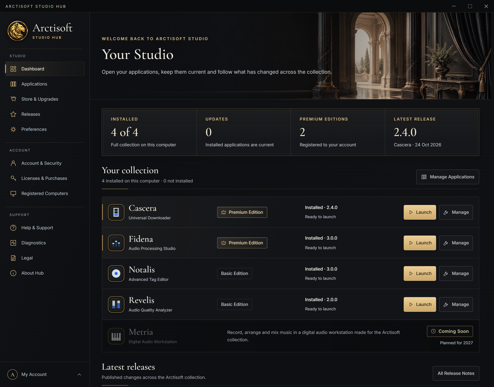

  

<h1 align="center">Arctisoft Studio Hub</h1>

<strong>Applications, Account &amp; Licenses for Windows</strong>

Your Arctisoft collection, managed from one place, free of charge

  <a href="https://github.com/Arctisoft-Studio/Arctisoft-Studio-Hub/releases/latest"><strong>Download</strong></a> ·
  <a href="https://arctisoft-studio.com/studio-hub/">Product website</a> ·
  <a href="https://arctisoft-studio.com/software/">The collection</a> ·
  <a href="https://github.com/Arctisoft-Studio/Arctisoft-Studio-Hub/releases">Release notes</a> ·
  <a href="https://arctisoft-studio.com/support/">Support</a>

 

The Dashboard with the installed collection, using fictional account data. More views in the <a href="https://arctisoft-studio.com/studio-hub/">product gallery</a>.

Arctisoft Studio Hub is the free companion to the Arctisoft collection. Install, update and launch the applications, sign in once for all of them, and manage your licenses, purchases, registered computers and account security in one place. Every application also installs, updates and runs on its own — the Hub makes the collection easier to manage, it is never required.

## Capabilities

- **Applications.** Install, launch, repair and remove Fidena, Revelis, Notalis and Cascera; read release notes; pin a version you want to keep.
- **Updates.** Choose whether Hub checks for and installs application updates while it is open. Pinned versions are preserved.
- **One sign-in.** The sign-in you make in Hub is shared with the applications on your Windows account, protected by Windows for your user.
- **Licenses and purchases.** Register product keys, see the major version each license covers, release a computer to use a license elsewhere, transfer a license where its terms allow, and export purchase records and license documents as PDF.
- **Store & Upgrades.** Current Basic and Premium offers for each application, with checkout through Stripe.
- **Account and security.** Profile, sign-in methods, password and authenticator protection, sessions, registered computers and account activity.
- **Privacy and help.** Account data export, account closure, the legal documents, diagnostics and support requests from Help & Support.

Guest mode provides application management, the store, release information and help. Licenses, orders and account settings require sign-in.

## The Arctisoft collection

| Application | For | Editions |
| --- | --- | --- |
| [Fidena](https://github.com/Arctisoft-Studio/Fidena-Audio-Processing-Studio) | Audio processing, repair, mastering and delivery | Basic · Premium |
| [Revelis](https://github.com/Arctisoft-Studio/Revelis-Audio-Quality-Analyzer) | Audio measurement, comparison and delivery checks | Basic · Premium |
| [Notalis](https://github.com/Arctisoft-Studio/Notalis-Advanced-Tag-Editor) | Metadata, artwork and library care | Basic · Premium |
| [Cascera](https://github.com/Arctisoft-Studio/Cascera-Universal-Downloader) | Media downloading and conversion | Basic · Premium |

Studio Hub itself is free. Premium licenses belong to the individual applications; see [current editions and pricing](https://arctisoft-studio.com/pricing/).

## System requirements

| | |
| --- | --- |
| Operating system | Windows 10 or Windows 11, 64-bit (x64) |
| Runtime | Included with the installer |
| Installation | For your Windows user account; administrator rights are not required |
| Internet | For sign-in, the store, license services, release information and downloads |

## Installation and updates

1. Download `v<version>-arctisoft.exe` from the [latest release](https://github.com/Arctisoft-Studio/Arctisoft-Studio-Hub/releases/latest).
2. Run the installer and accept the license agreement.
3. Start Studio Hub and sign in, or continue as a guest.

Studio Hub checks for a newer version of itself when it starts and installs it only after verifying the checksum GitHub publishes for the release. Applications are downloaded from their official release repositories in this organization.

## Accounts and privacy

Your account connects your profile, sign-in security, licenses, orders and registered computers. Payments are processed by Stripe; Arctisoft Studio never receives your card details. Studio Hub contains no analytics or telemetry and does not read your personal files. Account deletion is available in Account & Security; purchase records are kept only as long as Austrian tax law requires. The [Privacy Policy](https://arctisoft-studio.com/legal/privacy/) describes the data involved and your rights under the GDPR.

## Support

Open **Help & Support** in Hub, visit [Arctisoft Support](https://arctisoft-studio.com/support/) or write to [support@arctisoft-studio.com](mailto:support@arctisoft-studio.com). Report reproducible problems and suggest improvements through [GitHub Issues](https://github.com/Arctisoft-Studio/Arctisoft-Studio-Hub/issues). Please send account and purchase questions privately and never post passwords, product keys or personal records in public issues.

## License

Studio Hub is proprietary software provided free of charge. This repository holds its public documentation and official releases; the source code is not published. Use is governed by the [Studio Hub EULA](LICENSE), the [Arctisoft Studio License Agreement](https://arctisoft-studio.com/legal/license/) and the [Terms of Service](https://arctisoft-studio.com/legal/terms/). Open-source components are listed in **About Hub > Open-Source Licenses**.

---

© 2025–2026 Arctisoft Studio. All rights reserved.

